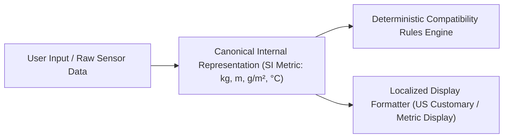

# SUZARCHI Global Expansion: Currency & Unit Conversion Architecture
**Programme:** SUZARCHI Global Circular Material Intelligence Platform  
**Document:** `docs/global-expansion/CURRENCY_AND_UNIT_ARCHITECTURE.md`  
**Status:** Strategic Architecture Blueprint (Pending Owner Review)

---

## 1. Multi-Currency Architectural Integrity

SUZARCHI enforces strict multi-currency rules to prevent exchange rate volatility from corrupting commercial agreements:

### 1.1 Supported Currencies (14 Initial Currencies)
- `USD`: United States Dollar (International Benchmark)
- `EUR`: Euro (European Union Standard)
- `GBP`: British Pound Sterling (United Kingdom)
- `INR`: Indian Rupee (South Asian Primary Hub)
- `CNY`: Chinese Yuan Renminbi (Mainland China)
- `TWD`: New Taiwan Dollar (Taiwan)
- `VND`: Vietnamese Dong (Southeast Asian Manufacturing)
- `CAD`: Canadian Dollar (North America)
- `JPY`: Japanese Yen (East Asia)
- `KRW`: South Korean Won (East Asia)
- `THB`: Thai Baht (Southeast Asia)
- `IDR`: Indonesian Rupiah (Southeast Asia)
- `MYR`: Malaysian Ringgit (Southeast Asia)
- `SGD`: Singapore Dollar (Regional Financial Hub)

### 1.2 Immutable Original Currency vs Indicative Display Price
- **Rule 1 (Immutability):** Every material listing, price quotation, and RFQ stores its amount with an explicit, immutable currency code (`originalCurrency`).
- **Rule 2 (No Silent Overwrite):** The platform **never** overwrites the seller's asking price with an auto-converted figure.
- **Rule 3 (Indicative Conversion Transparency):** When a user views a listing in their local currency, the UI explicitly shows both:
  ```
  Original Price: USD $1.45 / kg (Ex-Works Ho Chi Minh)
  Indicative Display: ₹121.80 / kg (Converted at 1 USD = 84.00 INR • Live reference: Nov 2, 2026, 10:00 UTC)
  ```
- **Rule 4 (Minor Currency Units):** Currencies with zero decimals (e.g., `VND`, `JPY`, `KRW`) are formatted with integer precision, while standard currencies use standard 2-decimal formatting.

---

## 2. Canonical Technical Unit Conversion System

In industrial textile engineering, rounding errors in weight or mass density result in machine jamming and failed dye batches. SUZARCHI enforces a **single, tested canonical conversion layer**:



### 2.1 Canonical Conversion Constants
- **Mass / Weight:**
  - Canonical Unit: `kg` (Kilogram).
  - $1\text{ lb} = 0.45359237\text{ kg}$ (Exact international avoirdupois pound).
  - $1\text{ oz} = 0.028349523125\text{ kg}$.
  - $1\text{ metric ton} = 1,000\text{ kg}$.
- **Fabric Area Density (Fabric Weight):**
  - Canonical Unit: `GSM` ($g/m^2$).
  - $1\text{ oz/yd}^2 = 33.90575\text{ GSM}$.
  - Conversion formula: $\text{GSM} = \text{oz/yd}^2 \times 33.90575$ | $\text{oz/yd}^2 = \text{GSM} / 33.90575$.
- **Length / Fabric Width:**
  - Canonical Unit: `m` (Metre).
  - $1\text{ inch} = 0.0254\text{ m}$ (Exact).
  - $1\text{ yard} = 0.9144\text{ m}$.
  - $1\text{ cm} = 0.01\text{ m}$.
- **Discrete Packaging Counts:**
  - Discrete units (`pieces`, `cones`, `drums`, `cartons`) are **strictly barred from continuous dimensional conversion** (e.g. 2,400 cones must never be converted to 2,400 lb).

---
*Document author: Global Product Architecture Team • November 2, 2026*
