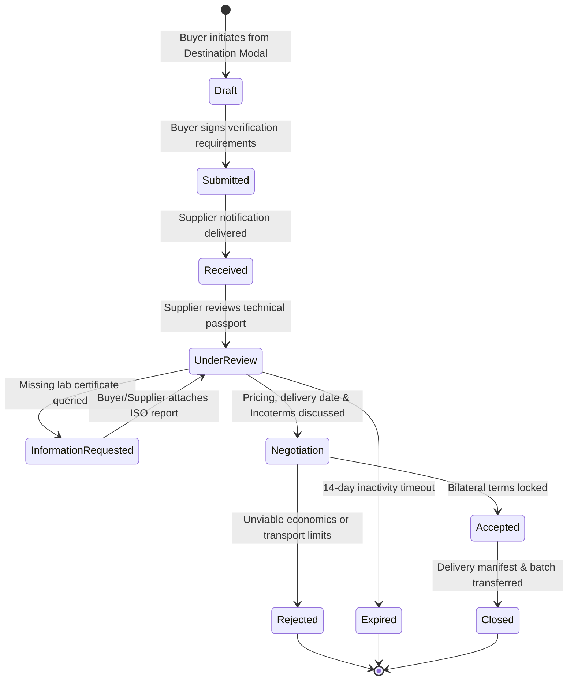

# SUZARCHI Global Expansion: Commercial Architecture & RFQ Workflow
**Programme:** SUZARCHI Global Circular Material Intelligence Platform  
**Document:** `docs/global-expansion/GLOBAL_COMMERCIAL_ARCHITECTURE.md`  
**Status:** Strategic Architecture Blueprint (Pending Owner Review)

---

## 1. Multi-Tier Business Profile Hierarchy

SUZARCHI recognizes 11 specialized organization types across the global circular material value chain:

1. **Agricultural & Natural Fibre Supplier:** Cotton growers, flax/linen farmers, wool cooperatives.
2. **Fibre Processing & Garnetting Mill:** Secondary fibre openers, mechanical pulling plants, rag tearers.
3. **Yarn Spinning Mill:** Ring, rotor open-end, and vortex spinning mills consuming secondary fibres.
4. **Fabric Mill (Knitting & Weaving):** Greige and finished textile fabric producers.
5. **Dyeing & Wet-Processing Unit:** Batch dyehouses, continuous dyeing ranges, printing mills.
6. **Garment & Apparel Manufacturer:** Cut-and-sew apparel export factories producing clip offcuts.
7. **Brand & Omni-Channel Retailer:** Consumer brands holding deadstock, excess rolls, and reverse logistics returns.
8. **Industrial & Technical Textile User:** Automotive tier-1 suppliers, geotextile contractors, filtration producers.
9. **Secondary Material Trader / Aggregator:** B2B waste dealers, scrap sorters, hydraulic baling operators.
10. **Recycling & Monomer Recovery Enterprise:** Chemical depolymerization, enzymatic recycling, PET glycolysis plants.
11. **Statutory Waste Recovery & Co-Processing Facility:** Licensed cement kiln AFRM operators, hazardous TSDF sites, CBWTF incinerators.

### Business Verification Governance
Every registered organization is assigned an explicit verification level:
- `UNVERIFIED_SELF_DECLARED`: Basic registration completed; commercial transactions restricted.
- `BUSINESS_REGISTRY_VERIFIED`: Legal entity verified via national registry (e.g. GSTIN in India, EIN/W-9 in US, SIREN in France, VAT in EU).
- `TECHNICAL_FACILITY_AUDITED`: Physical mill address, installed machinery capacity, and environmental permits audited by accredited third-party inspector.

---

## 2. Commercial Material Listing Schema

```typescript
export interface CommercialMaterialListing {
  id: string;                         // Unique listing ID, e.g. "list-2026-0894"
  passportId: string;                 // Foreign key to Digital Material Passport
  supplierOrgId: string;              // Foreign key to verified Organisation
  supplierCountry: string;            // ISO Alpha-2
  originStorageLocation: string;      // Physical warehouse address & cluster
  availableQuantity: number;          // Stored canonical quantity
  quantityUnit: string;               // e.g. "kg", "bales", "rolls"
  minimumOrderQuantity: number;       // MOQ threshold for circular viability
  askingPricePerUnit: number;         // Stored in original currency
  originalCurrency: string;           // e.g. "USD", "EUR", "INR", "VND"
  pricingBasis: 'EX_WORKS' | 'FOB_PORT' | 'CIF_DESTINATION';
  applicableIncoterm?: 'EXW' | 'FOB' | 'CIF' | 'DDP';
  packagingFormat: 'HYDRAULIC_BALES' | 'FABRIC_ROLLS' | 'DRUMS' | 'BOXES';
  exportEligibility: 'DOMESTIC_ONLY' | 'REGIONAL_CROSS_BORDER' | 'GLOBAL_EXPORT';
  exportRestrictions?: string[];      // e.g. ["BASEL_CONVENTION_PRIOR_INFORMED_CONSENT", "WASTE_EXPORT_BAN"]
  listingStatus: 'ACTIVE' | 'PENDING_LAB' | 'RESERVED' | 'CLOSED';
}
```

---

## 3. Eleven-Step Global RFQ Lifecycle

To prevent fabricated transactions or unauthorized dispatches, RFQs advance through a strict state machine:



---
*Document author: Global Product Architecture Team • November 2, 2026*
