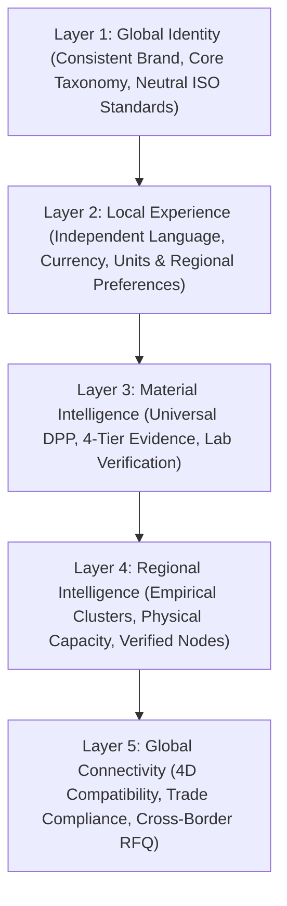

# SUZARCHI Global Expansion: Product Vision & Positioning
**Programme:** SUZARCHI Global Circular Material Intelligence Platform  
**Product Identity:** SUZARCHI — சுழற்சி  
**Tagline:** One Material. Multiple Possibilities.  
**Document:** `docs/global-expansion/GLOBAL_PRODUCT_VISION.md`  
**Status:** Strategic Architecture Blueprint (Pending Owner Review)

---

## 1. Executive Vision

SUZARCHI (சுழற்சி) is conceived as an internationally capable, evidence-based circular-material intelligence platform. While India represents an invaluable foundational manufacturing and supply ecosystem, the long-term mission of SUZARCHI transcends national borders.

The platform connects the entire global textile and circular-material lifecycle:
- Agricultural and raw-fibre producers.
- Ginning, opening, and mechanical fibre reclaimers.
- Spinning, twisting, and texturizing mills.
- Weaving, knitting, and non-woven manufacturers.
- Wet-processing, dyeing, and finishing plants.
- Garment factories and fashion design ateliers.
- Global apparel brands and omni-channel retailers.
- Industrial, automotive, and technical textile users.
- Secondary material traders, sorters, and aggregators.
- Mechanical, thermo-mechanical, and chemical recyclers.
- Regulated waste co-processing and recovery facilities.
- Institutional buyers and individual consumers.

---

## 2. Fundamental Product Principle

```
"A material that is surplus, unused, underutilised or discarded in one location
may be a valuable resource for another industry, another business or another country."
```

In conventional global supply chains, secondary textiles are discarded, downcycled prematurely, or landfilled due to information asymmetry, lack of verifiable physical specifications, and absence of cross-border destination intelligence. SUZARCHI systematically eliminates this asymmetry through **deterministic material intelligence, multi-tiered evidence verification, regional cluster data, and four-dimensional compatibility matching**.

---

## 3. International Positioning

**Canonical Positioning Statement:**
> **SUZARCHI — A Global Circular Material Intelligence Platform**

**Canonical Tagline:**
> **One Material. Multiple Possibilities.**

**Supporting Value Proposition:**
> *"Connecting materials, industries and opportunities across borders through intelligent material identification, compatibility analysis and circular-economy networks."*

### Explicit Positioning Boundaries:
To ensure brand integrity, SUZARCHI must **never** be presented as:
- Merely an Indian recycling marketplace.
- A basic textile scrap listing website.
- A municipal waste-management utility.
- A generic, unverified B2B classifieds portal.

Instead, SUZARCHI is an **enterprise-grade decision engine and digital product passport (DPP) ecosystem** that fuses deep textile engineering physics, deterministic safety gating, and verified regional logistics.

---

## 4. The Five Foundational Layers



1. **Global Identity:** One unified, recognizable brand identity (`SUZARCHI — சுழற்சி`) anchored in universal textile physics, standardized lifecycle taxonomies, and neutral international identifiers.
2. **Local Experience:** User-centric configuration permitting full independence between language, country of operation, display currency, and measurement systems.
3. **Material Intelligence:** A single, unshakeable source of material truth — the Digital Material Passport — where evidence governance (`CONFIRMED`, `REPORTED`, `ESTIMATED`, `UNKNOWN`) is universally enforced regardless of language or market.
4. **Regional Intelligence:** Deeply grounded, empirical mapping of physical manufacturing clusters, processing capabilities, and logistics corridors, strictly distinguishing verified facts from modeled estimates.
5. **Global Connectivity:** Intelligent matching that evaluates not just technical affinity, but safety eligibility, missing laboratory evidence, commercial viability, and cross-border trade compliance (e.g., Basel Convention, EU DPP).

---
*Document author: Global Product Architecture Team • November 2, 2026*
