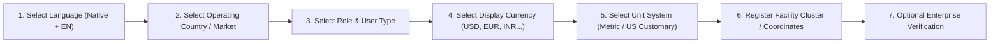

# SUZARCHI Global Expansion: UX & Information Architecture
**Programme:** SUZARCHI Global Circular Material Intelligence Platform  
**Document:** `docs/global-expansion/GLOBAL_UX_INFORMATION_ARCHITECTURE.md`  
**Status:** Strategic Architecture Blueprint (Pending Owner Review)

---

## 1. Global User Onboarding Experience

To accommodate diverse international users—from small handloom weavers in Tamil Nadu to corporate sustainability officers in New York or Frankfurt—SUZARCHI establishes a modular 9-step onboarding workflow:



---

## 2. Future Global Navigation Architecture

The navigation model cleanly accommodates global marketplace and intelligence features without overcrowding the approved hackathon dashboard:

```
SUZARCHI Global Navigation Framework
├── 1. Dashboard (Unified Overview, KPI Metrics, LCA Avoidance)
├── 2. Material Inventory (Local & Enterprise Batch Listings)
├── 3. Digital Material Passport (DPP Verification, Chain of Custody, Lab Certificates)
├── 4. Circular Match Engine (4D Compatibility, Requirements Audit, Missing Evidence)
├── 5. Global Marketplace (Cross-Border Listings, Certified Secondary Materials)
├── 6. Industrial Networks (Verified Spinning Mills, Recyclers, Cement Kilns)
├── 7. Regional Intelligence (Industrial Textile Clusters, Logistics Corridors, Ports)
├── 8. RFQ & Trade Desk (In-Memory Drafting, Bilateral Negotiation, Manifests)
├── 9. Compliance & Traceability (EU DPP Alignment, Waste Codes, LCA Reporting)
└── 10. Organization & Settings (Locale, Multi-Currency, Facility Permissions)
```

---

## 3. Tiered Regional Dashboard Views

Users can dynamically toggle their dashboard scope:
- **`My Region` (Intra-Cluster):** Displays local opportunities within a 100 km radius (e.g., Tiruppur–Coimbatore, Prato district). Maximizes logistics cost efficiency and minimizes transport emissions.
- **`My Country` (Domestic Network):** Displays national circular opportunities (e.g., shipping Tiruppur knit waste to Panipat shoddy blanket mills).
- **`Global Opportunities` (Cross-Border):** Displays international containerized trade opportunities meeting Basel Convention criteria and minimum operating thresholds.

---

## 4. Accessibility & Responsive Standards

- **WCAG 2.1 Level AA Compliance:** High contrast color ratios (≥ 4.5:1 for normal text, ≥ 3.0:1 for large badges and controls).
- **Responsive Viewport Fidelity:** Validated across mobile smartphones (360×800, 390×844), tablets (768×1024), and widescreen desktop monitors (1440×900).
- **Touch-First Ergonomics:** Minimum interactive touch targets of $48\times 48\text{ px}$ with tactile feedback.
- **Screen Reader Readiness:** Semantic HTML5 structure (`<main>`, `<nav>`, `<dialog role="dialog">`) with full ARIA live regions for dynamic calculations.

---
*Document author: Global Product Architecture Team • November 2, 2026*
