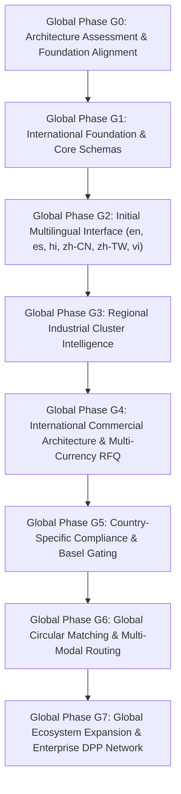

# SUZARCHI Global Expansion: Staged Implementation Roadmap
**Programme:** SUZARCHI Global Circular Material Intelligence Platform  
**Document:** `docs/global-expansion/IMPLEMENTATION_ROADMAP.md`  
**Status:** Strategic Architecture Blueprint (Pending Owner Review)

---

## 1. Roadmap Architecture & Execution Principles

SUZARCHI’s international expansion is structured into eight progressive phases (G0 through G7). Every phase is bounded by strict acceptance criteria, automated regression gates, and zero disruption to the existing MVP baseline.

---

## 2. Granular Milestone Phase Specifications

### Global Phase G0: Architecture Assessment & Baseline Alignment
- **Objective:** Complete full baseline audit, establish isolation boundaries, and resolve Phase 7 reconciliation findings.
- **Key Deliverables:** 
  - Complete 15-document global architecture blueprint package (`docs/global-expansion/`).
  - Owner-approved fix for React Error #310 in `PostMaterialModal.tsx`.
  - Reconciled Phase 7 evidence package (`phase7-acceptance-evidence.zip`).
- **Gate Criteria:** 100% test pass on behavioural suite Gate 1 through Gate 7. Zero code changes outside approved minimal fix.

### Global Phase G1: International Foundation & Core Schemas
- **Objective:** Deploy foundational TypeScript schemas for Countries, Currencies, Languages, Units, and Translation Glossaries.
- **Key Deliverables:**
  - `src/i18n/config.ts`, `src/i18n/locales.ts`, `src/i18n/formatters.ts`.
  - Canonical unit conversion layer with bidirectional drift-free tests.
  - Multi-currency data model storing explicit currency codes.
- **Gate Criteria:** Unit conversion suite validates 1,000 round-trip conversions with zero compounding drift. Zero hardcoded currency symbols in core logic.

### Global Phase G2: Initial Multilingual Interface
- **Objective:** Launch first 6 priority languages: English (`en`), Spanish (`es`), Hindi (`hi`), Simplified Chinese (`zh-CN`), Traditional Chinese (`zh-TW`), and Vietnamese (`vi`).
- **Key Deliverables:**
  - Centralized message catalogues in `src/i18n/messages/`.
  - Accessible, searchable language selector modal with native script display.
  - Devanagari and CJK font fallbacks active in design system.
- **Gate Criteria:** 100% translation key coverage across all 6 languages. Zero layout clipping on German/French expansion tests.

### Global Phase G3: Regional Industrial Cluster Intelligence
- **Objective:** Expand regional intelligence module beyond South India to encompass North America, Europe, China, Taiwan, and Vietnam.
- **Key Deliverables:**
  - Empirical mapping of physical textile clusters (e.g., Charlotte NC, Prato Italy, Zhejiang China, Ho Chi Minh Vietnam).
  - Explicit demarcation between `[VERIFIED CLUSTER FACT]` and `[LOGISTICS ESTIMATE MODEL]`.
- **Gate Criteria:** Every regional facility record links to statutory business registry ID or environmental license. Zero synthetic/invented mill records.

### Global Phase G4: International Commercial Architecture & Multi-Currency RFQ
- **Objective:** Implement international business profiles, commercial listings, and multi-currency in-memory RFQ drafting.
- **Key Deliverables:**
  - Organization profiles for 11 circular entity types.
  - Multi-currency price quotation display with transparent live exchange rate timestamps.
  - 11-step RFQ state machine operating in-memory with zero external network leakage.
- **Gate Criteria:** RFQ submission maintains complete local isolation without dispatching unapproved emails or external network calls.

### Global Phase G5: Country-Specific Compliance & Basel Gating
- **Objective:** Implement modular regulatory checks for cross-border secondary material transfers.
- **Key Deliverables:**
  - Basel Convention transboundary waste movement rules matrix.
  - EU ESPR Digital Product Passport compliance alignment checker.
  - Universal safety lockouts permanently enforced across all jurisdictions.
- **Gate Criteria:** Infectious healthcare linen (`CAT-MED-BED-INF`) and petroleum oily rags (`CAT-WRK-OIL-HAZ`) unconditionally blocked from international open-loop export.

### Global Phase G6: Global Circular Matching Engine
- **Objective:** Expand the 4-dimensional matching engine to evaluate international multi-modal logistics, ocean container MOQs, and landed tariffs.
- **Key Deliverables:**
  - Landed cost calculator factoring ocean freight (FCL vs LCL), customs duties, and port handling.
  - Cross-border match explanation cards detailing technical, safety, evidence, and commercial barriers.
- **Gate Criteria:** Engine successfully evaluates complex cross-border scenarios (e.g. Vietnam polyester scrap to India spinning mills) with transparent mathematical explanations.

### Global Phase G7: Global Ecosystem Expansion & Enterprise DPP Network
- **Objective:** Launch verified enterprise partner networks, third-party laboratory API integrations, and audited Scope 3 LCA avoidance reporting.
- **Key Deliverables:**
  - Accredited laboratory test certificate verification portal (ISO/IEC 17025).
  - Enterprise multi-facility inventory synchronization.
  - Automated Digital Product Passport QR code generator conforming to EU ESPR standards.
- **Gate Criteria:** Full end-to-end audit trail verified from factory cut offcut to regenerated garment yarn.

---
*Document author: Global Product Architecture Team • November 2, 2026*
