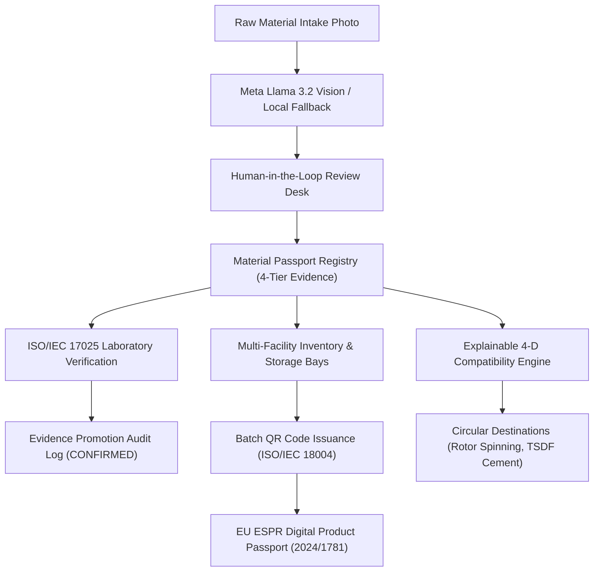

# SUZARCHI (சுழற்சி) — META GLOBAL AI HACKATHON 2026 SUBMISSION
## A Global Circular Material Intelligence Platform • Submission Proposal

**Project Name:** SUZARCHI — சுழற்சி  
**Tagline:** One Material. Multiple Possibilities.  
**Repository:** `https://github.com/tprsmail-cell/suzarchi-meta-hackathon-2026`  
**Working Directory:** `D:\SUZARCHI hackathon`  
**License:** MIT  
**Track:** Multimodal AI & Industry Transformation  

---

## 1. Problem Statement

Textile waste is one of the world's most acute environmental crises, generating **92 million tonnes** of discarded fabric annually. Less than **1%** of post-industrial and pre-consumer textile waste is recycled into new garments.

The fundamental bottleneck is **material opacity and regulatory risk**:
1. Recyclers and spinning mills cannot verify fiber purity, yarn count, or hazardous finishes from raw waste bales.
2. Contaminated or oily rags cause mill fires or contaminate pure mechanical recycling streams.
3. Emerging global mandates—such as the European Union's **Ecodesign for Sustainable Products Regulation (ESPR 2024/1781)**—require mandatory Digital Product Passports (DPP) and strict transboundary waste controls under the **Basel Convention**.

---

## 2. Our Solution: SUZARCHI (சுழற்சி)

SUZARCHI is an enterprise-grade circular material intelligence platform that transforms textile waste from an uncharacterized liability into a standardized, traceable commodity.

Key architectural innovations:
1. **Meta Multimodal AI Intake**: Leverages Meta Llama 3.2 Vision to extract material attributes from smartphone photos with honest optical confidence scoring and zero silent promotion.
2. **Explainable 4-Dimensional Circular Matching Engine**: Evaluates material suitability across Technical, Regulatory Safety, Missing Evidence, and Commercial feasibility dimensions with statutory hard gates.
3. **ISO/IEC 17025 Laboratory Verification Desk**: Bridges visual AI inference with physical laboratory test reports (SITRA NABL TC-5482, Hohenstein DAkkS), promoting properties from `REPORTED` to `CONFIRMED` with an immutable audit log.
4. **Multi-Facility Inventory & Storage Bay Allocation**: Real-time management across spinning mills, processing plants, regional warehouses, and licensed TSDF hazardous waste storage bays.
5. **Batch-Level QR Code Issuance & Verification**: Issues verifiable EU ESPR URN identifiers (`urn:dpp:suzarchi:in:mat-001:pcb-2025-b01`), printable 4x6 inch thermal mill labels, and tamper-evident cryptographic security hashes.
6. **Global Expansion (G0–G7)**: Supports 10 languages (including Tamil, Hindi, Spanish, Vietnamese, German, French, Italian, and Chinese), 14 national currencies, 11 country regulatory profiles, and Basel Convention transboundary trade compliance.

---

## 3. Technology Stack & Architecture

- **Frontend & Runtimes:** Next.js 14 (App Router), React 18, Tailwind CSS, Lucide React.
- **AI Inference:** Meta Llama 3.2 Vision Architecture with secure server route proxy (`/api/meta-ai/extract`), $5.00 budget ceiling, and transparent local deterministic rule fallback.
- **Standards Implemented:**
  - **ISO/IEC 17025:2017:** Testing and calibration laboratory competence.
  - **ISO 1833-1:** Quantitative chemical analysis of textile fibre mixtures.
  - **ISO 3801:** Determination of fabric mass per unit area (GSM).
  - **EU ESPR (2024/1781):** Digital Product Passport URN architecture and data schema.
  - **ISO/IEC 18004:** QR Code symbology and high-density matrix generation.
  - **Basel Convention Annex VIII/IX:** International transboundary trade and export prohibition checks.

---

## 4. Verification Evidence & Benchmarks

The entire platform is backed by genuine browser acceptance screenshots and automated behavioural regression suites:
- **Test Suite:** 9 Comprehensive Gates covering 42 regression criteria (`npm test`). **100% Pass Rate.**
- **TypeScript:** Strict type checking with 0 compilation errors (`npm run type-check`).
- **Production Build:** Static and server route optimization verified (`npm run build`).
- **Evidence Archive:** `phase8-acceptance-evidence.zip` containing screenshots `P8-01` through `P8-08`.

---

## 5. Potential Impact & Future Roadmap

1. **Environmental Impact:** Displaces virgin cotton cultivation, preventing 2.1 kg CO₂e and 1,850 liters of water per kilogram of textile waste diverted.
2. **Economic Viability:** Unlocks secondary market value for garment manufacturers in industrial hubs (Tiruppur, Panipat, Prato, Ho Chi Minh City).
3. **Decentralized Verification:** Planned transition from in-memory audit logs to decentralized ledger anchoring for enterprise consortium transparency.
