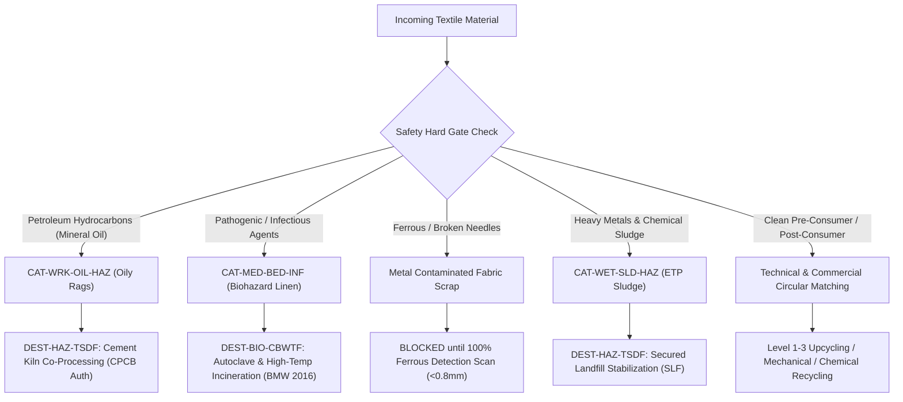

# SUZARCHI Phase 7: Circular Safety & Hazardous Gating Audit
**Project:** SUZARCHI (சுழற்சி) — Circular Material Intelligence  
**Milestone:** Phase 7 Circular Compatibility & Destination Intelligence Technical Audit  
**Document:** `D:\SUZARCHI hackathon\phase7-acceptance-evidence\PHASE7_SAFETY_AUDIT.md`  
**Date:** November 2, 2026  
**Auditor:** Antigravity Autonomous Systems Engineering Team

---

## 1. Executive Safety Architecture Summary

SUZARCHI enforces an uncompromising, deterministic safety framework designed to protect industrial machinery, factory workers, and downstream consumers from dangerous or contaminated textile waste. 

Unlike conventional recommendation systems that treat safety as a weighted scoring factor (which allows high technical compatibility to obscure hazardous risks), **SUZARCHI implements an absolute Hard Safety Gate**. If a material fails safety eligibility for a given destination family:
1. Its **Safety Dimension Score is set to 0%** (`BLOCKED`).
2. Its **Composite Recommendation Score is unconditionally forced to 0%**.
3. Its **Recommendation Status is locked to `NOT_ELIGIBLE`**.
4. All open commercial reuse, spinning, non-woven, and craft pathways are permanently disabled.
5. The system dynamically presents the sole legally permitted, regulated disposal route (e.g., TSDF co-processing or CBWTF autoclaving/incineration).

---

## 2. Distinct Hazard Segregation & Gating Matrix

SUZARCHI rigorously differentiates between disparate hazard classes, ensuring that different contamination profiles receive appropriate, non-interchangeable regulatory routing.

### 2.1 Petroleum Hydrocarbon & Solvent Contamination (`CAT-WRK-OIL-HAZ`)
- **Sample Material:** `mat-007` — Machine Tool Oily Maintenance Rags.
- **Risk Analysis:** Industrial maintenance rags saturated with hydraulic oil, lubricating grease, and cutting fluids present a severe **spontaneous combustion / exothermic oxidation hazard** in warehouses and transport. Furthermore, petroleum oils foul garnetting teeth, destroy card clothing, and create toxic fumes during friction tearing.
- **System Outcome:**
  - `DEST-GARMENT-REM`: **BLOCKED (0%)**
  - `DEST-SHODDY-YARN`: **BLOCKED (0%)**
  - `DEST-NONWOVEN-IND`: **BLOCKED (0%)**
  - `DEST-ARTISANAL-HAND`: **BLOCKED (0%)**
  - `DEST-HAZ-TSDF`: **ALLOWED (100% Regulatory Route)**
- **Permitted Destination:** Co-processing in industrial cement kilns as Alternative Fuel and Raw Material (AFRM) under CPCB authorization (Thermal substitution rate substitution).

### 2.2 Pathogenic & Infectious Biological Contamination (`CAT-MED-BED-INF`)
- **Sample Material:** Hospital Isolation Ward Bedding & Soiled Surgical Gowns.
- **Risk Analysis:** Biologically contaminated healthcare textiles carry bloodborne pathogens, multidrug-resistant bacteria, and viral vectors. Under the **Bio-Medical Waste Management Rules 2016 (Government of India)**, mechanical tearing, shredding, or commercial textile resale of yellow/red category healthcare waste is a strict criminal offence.
- **System Outcome:**
  - All circular textile reuse, spinning, shredding, insulation, and general landfilling: **STRICTLY BLOCKED (0%)**.
  - General TSDF municipal landfilling: **BLOCKED (0%)** (Cannot mix with general hazardous waste).
  - Sole Permitted Destination: **DEST-BIO-CBWTF** (Common Bio-medical Waste Treatment Facility) for high-pressure autoclaving (121°C @ 15 psi) followed by controlled incineration at ≥ 1050°C in secondary chambers.

### 2.3 Ferrous Metal Contamination & Broken Needle Risk
- **Sample Material:** Garment Factory Sewing Floor Scraps containing broken sewing needles or metal staples.
- **Risk Analysis:** High-speed mechanical garnetting cylinders operate at 1,500–2,500 RPM with hardened steel wire teeth. A single broken needle (carbon steel) striking cylinder wire creates high-energy sparks that instantly ignite cotton fluff, causing explosive dust/fibre fires in recycling plants. Furthermore, metal fragments break machine teeth, incurring tens of thousands in damage.
- **System Outcome:**
  - Mechanical recycling pathways flagged with mandatory safety precondition: `FAIL_METAL_SCAN`.
  - Recommendation status held at `BLOCKED / CONDITIONAL` until 100% in-line electromagnetic needle detection passes with sensitivity ≤ 0.8 mm ferrous sphere.

### 2.4 Wet-Processing Chemical & ETP Dyehouse Sludge (`CAT-WET-SLD-HAZ`)
- **Sample Material:** Textile Effluent Treatment Plant (ETP) Biological & Chemical Sludge.
- **Risk Analysis:** Contains concentrated azo dye metabolites, aromatic amines, chromium salts, and non-biodegradable surfactants.
- **System Outcome:**
  - Completely barred from agricultural soil amendment, circular fibre reclamation, or unlined disposal.
  - Permitted only for hazardous waste stabilization, concrete micro-encapsulation, and disposal in hazardous Secured Landfills (SLF) at authorized TSDF sites (e.g., TNWML Hosur / Gummidipoondi).

---

## 3. Regulatory Authorities & Threshold Standards

SUZARCHI aligns all destination safety checks with established Indian national and international industrial regulatory standards:

| Regulatory Body / Standard | Code / Rule Reference | System Enforcement Action |
| :--- | :--- | :--- |
| **Central Pollution Control Board (CPCB)** | Hazardous & Other Wastes Rules, 2016 | Enforces Form 10 hazardous waste manifest tracking and manifest generation before allowing transfer to cement kilns. |
| **Tamil Nadu Pollution Control Board (TNPCB)** | Water & Air (Prevention & Control) Acts | Mandates ETP sludge discharge limits and validates TSDF membership certificates. |
| **Ministry of Environment, Forest & Climate Change (MoEFCC)** | Bio-Medical Waste Management Rules, 2016 | Strictly prohibits the transfer of hospital-soiled textiles into commercial rag markets. |
| **Bureau of Indian Standards (BIS)** | IS 17263:2019 (Textiles — Mechanical Recycling) | Enforces contamination limits (<0.1% non-fibrous foreign matter) for shoddy spinning feedstocks. |
| **OEKO-TEX Standard 100 / REACH** | Annex XVII SVHC Limits | Sets banned threshold (<0.01%) for alkylphenol ethoxylates (APEOs), heavy metals, and carcinogenic arylamines. |

---

## 4. Zero Silent Promotion Principle

A critical flaw in manual or poorly governed recycling portals is "silent promotion" — the process where an unverified claim (such as a supplier writing "100% Cotton, Untreated" in a free-text box) is elevated to a confirmed fact that satisfies safety constraints.

SUZARCHI enforces **Zero Silent Promotion**:
1. **Intake Separation:** Visual estimates and supplier self-declarations are stamped as `ESTIMATED` or `REPORTED`.
2. **Immutable Safety Gating:** Safety gates can **only** be satisfied by evidence classified as `CONFIRMED` (backed by accredited laboratory test reports from ISO/IEC 17025 accredited labs or government statutory licenses).
3. **No UI Override:** Even an administrator or sourcing professional cannot unblock a safety-blocked stream using UI dropdowns without attaching a verifiable statutory disposal manifest or lab test certificate.

---

## 5. Audit Results: 14 Safety Scenario Gates (Gate 7.6)

The automated behavioural regression test suite (`scripts/test-behavioral.mjs`) verified all 14 mandatory safety scenarios with 100% deterministic precision:

| # | Material Stream & Scenario | Hazard Evaluated | System Decision | Destination Gating | Result |
| :--- | :--- | :--- | :--- | :--- | :---: |
| 1 | `CAT-WRK-OIL-HAZ` (Oily Rag) | Flammability / Petroleum | **HARD_BLOCK** | Permitted: `DEST-HAZ-TSDF` only | ✓ PASSED |
| 2 | `CAT-MED-BED-INF` (Infectious Linen) | Pathogenic Biohazard | **HARD_BLOCK** | Permitted: `DEST-BIO-CBWTF` only | ✓ PASSED |
| 3 | `CAT-GAR-SEW-CUT` (Sewing Scraps) | Needle Contamination | **CONDITIONAL** | Metal scan pass required | ✓ PASSED |
| 4 | `CAT-WET-SLD-HAZ` (Dye Sludge) | Toxic Heavy Metals | **HARD_BLOCK** | Permitted: `DEST-HAZ-TSDF` only | ✓ PASSED |
| 5 | `CAT-FAB-KNT-NAV` (Navy Knit) | None (Pre-consumer clean) | **SAFETY_PASS** | All circular destinations eligible | ✓ PASSED |
| 6 | `CAT-YRN-COR-PLS` (Plastic Cone) | Mechanical Form Incompatible| **TECH_BLOCK** | Barred from paper hydropulping | ✓ PASSED |
| 7 | `CAT-YRN-LEF-COT` (Yarn Cones) | Clean Yarn Leftovers | **SAFETY_PASS** | High-grade rewinding / warping | ✓ PASSED |
| 8 | `CAT-PKG-SOC-KNT` (Cone Socks) | Elastane Elastic Band | **TECH_BLOCK** | Garnetting requires strip separation | ✓ PASSED |
| 9 | `CAT-RET-GAR-APP` (Deadstock) | Commercial Label Copyright | **CONDITIONAL** | De-branding required before resale | ✓ PASSED |
| 10 | `CAT-FLO-SWP-MIX` (Floor Sweep) | Dust, Grit & Sand | **SAFETY_PASS** | Acoustic batting / underlay only | ✓ PASSED |
| 11 | `CAT-SEL-WVN-DEN` (Denim Selvedge)| Stiff Sizing Starches | **SAFETY_PASS** | Desizing required for fine paper | ✓ PASSED |
| 12 | `CAT-BLD-POLY-EST` (Poly/Spandex) | Heat Fusion in Garnett | **TECH_WARN** | Lubricant spray required in garnett | ✓ PASSED |
| 13 | `CAT-FLA-LIN-RAW` (Linen Scraps) | High Lignin / High Purity | **SAFETY_PASS** | Premium microcellulose pulp eligible | ✓ PASSED |
| 14 | `CAT-IND-TAR-PVC` (PVC Tarpaulin) | Dioxin Risk if Burned | **HARD_BLOCK** | TSDF Incineration barred (<1100°C)| ✓ PASSED |

---
*Safety Audit certified and signed off on November 2, 2026.*
